# FabLab: Model Storming (Diagrams as Code)

Modelagem do **Sistema FabLab**: reservas de máquinas, fila de prioridade, manutenção, estoque de insumos e compras.

> 📌 Decisões de modelagem e pendências: [`docs/DECISOES-E-PENDENCIAS.md`](docs/DECISOES-E-PENDENCIAS.md)

## Arquivos

| Diagrama | Arquivo |
|---|---|
| Contexto (C4 Nível 1) | [`c4-contexto-visual.mmd`](docs/architecture/c4-contexto-visual.mmd) · notação C4 oficial: [`c4-contexto.mmd`](docs/architecture/c4-contexto.mmd) |
| Contêineres (C4 Nível 2) | [`c4-containers-visual.mmd`](docs/architecture/c4-containers-visual.mmd) · notação C4 oficial: [`c4-containers.mmd`](docs/architecture/c4-containers.mmd) |
| Sequência: reserva com cenários de falha | [`sequencia-reserva.mmd`](docs/architecture/sequencia-reserva.mmd) |
| Sequência: compra de insumos | [`sequencia-compra.mmd`](docs/architecture/sequencia-compra.mmd) |
| Sequência: manutenção de máquina | [`sequencia-manutencao.mmd`](docs/architecture/sequencia-manutencao.mmd) |
| Classes: interfaces e injeção de dependência | [`classes-interfaces.mmd`](docs/architecture/classes-interfaces.mmd) |
| Modelo de domínio | [`modelo-dominio.mmd`](docs/architecture/modelo-dominio.mmd) |
| Componentes da API Backend (C4 Nível 3) | [`componentes.mmd`](docs/architecture/componentes.mmd) |
| Atividades: reserva | [`atividade-reserva.mmd`](docs/architecture/atividade-reserva.mmd) |
| Atividades: cancelamento | [`atividade-cancelamento.mmd`](docs/architecture/atividade-cancelamento.mmd) |
| Estados da Reserva | [`estados-reserva.mmd`](docs/architecture/estados-reserva.mmd) |
| Estados do Pedido de Compra | [`estados-pedido-compra.mmd`](docs/architecture/estados-pedido-compra.mmd) |
| ADR 0001: RabbitMQ + Outbox | [`docs/adr/0001-escolha-tecnologica.md`](docs/adr/0001-escolha-tecnologica.md) |
| Casos de uso | [`docs/architecture/casos-de-uso.pdf`](docs/architecture/casos-de-uso.pdf) |
| Visão de Domínio e Backlog | [`docs/visao-dominio-e-backlog.pdf`](docs/visao-dominio-e-backlog.pdf) |
| Plano de Chaos Engineering | [`docs/architecture/chaos_engineering.pdf`](docs/architecture/chaos_engineering.pdf) |
| Validação cross-diagramas | [`docs/architecture/validacao_cross_diagramas_fablab_dia27.pdf`](docs/architecture/validacao_cross_diagramas_fablab_dia27.pdf) |

Os arquivos `.mmd` são a fonte oficial. Os blocos abaixo são cópias deles para visualização no GitHub.

## 1. Contexto (C4 Nível 1)

Azul-escuro: pessoas. Azul: o Sistema FabLab. Cinza: sistemas externos.

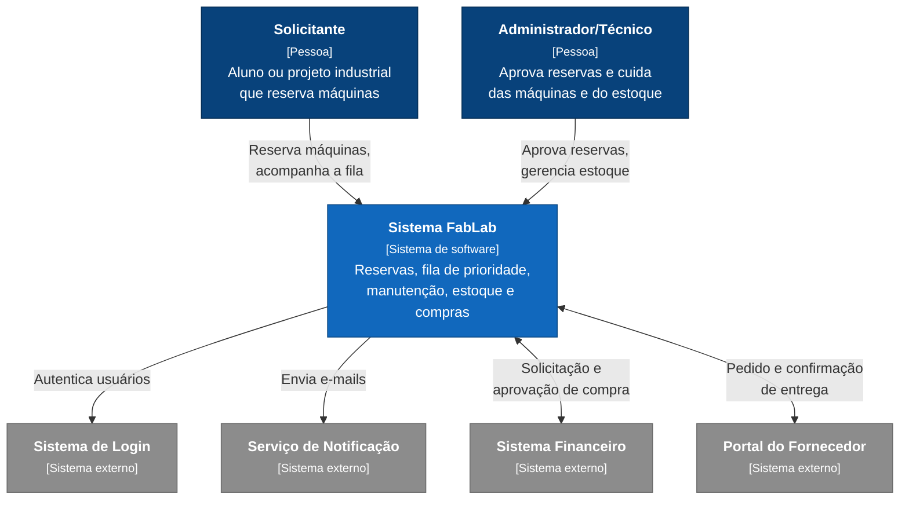

Versão na notação C4 oficial do Mermaid (<code>c4-contexto.mmd</code>)

O layout automático do C4 no Mermaid é limitado e cruza algumas setas. O conteúdo é o mesmo da versão acima.

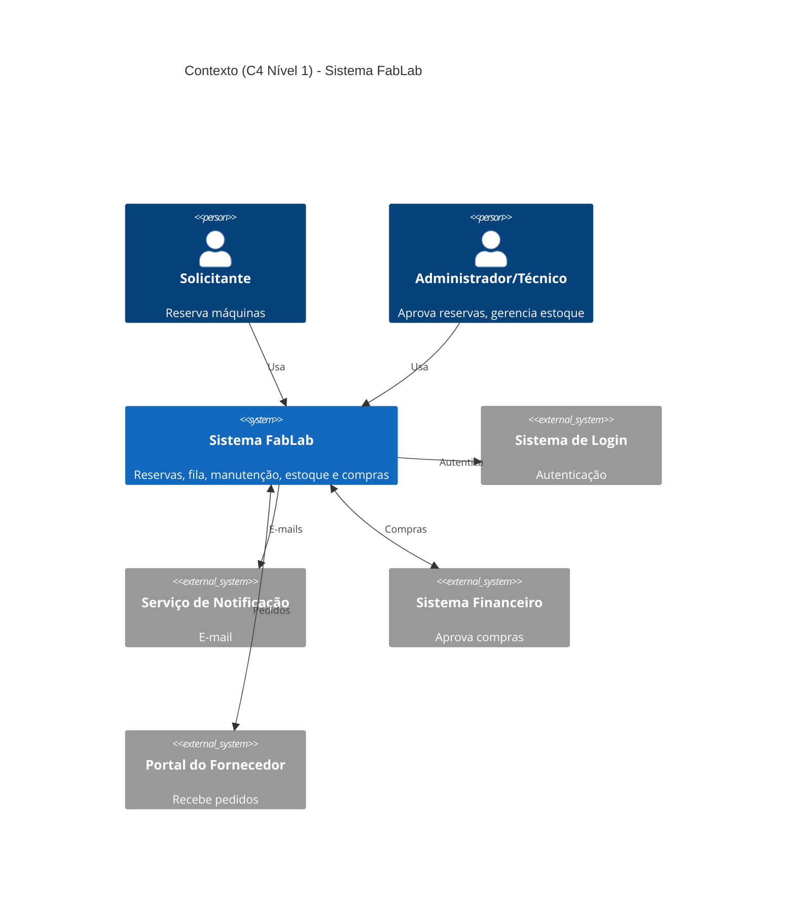

## 2. Contêineres (C4 Nível 2)

Passo 1 do laboratório. Azul: contêineres do Sistema FabLab. Cinza: sistemas externos. Análise em [`auditoria-c4-containers.md`](docs/architecture/auditoria-c4-containers.md).

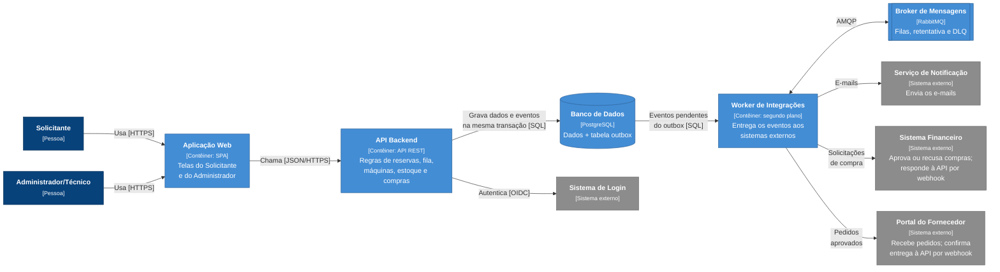

Versão na notação C4 oficial do Mermaid (<code>c4-containers.mmd</code>)

O layout automático do C4 no Mermaid é limitado e cruza algumas setas. O conteúdo é o mesmo da versão acima.

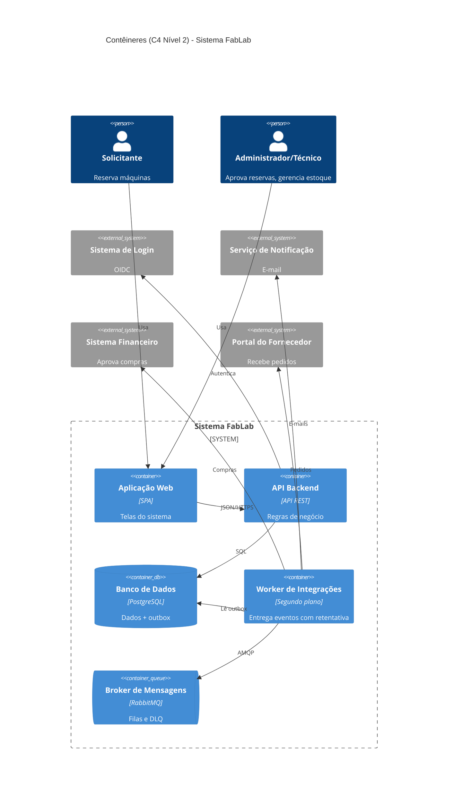

## 3. Sequência: reserva com cenários de falha

Passo 2 do laboratório. **FALHA 1:** banco não responde em 3 s. **FALHA 2:** Serviço de Notificação fora do ar, com retentativa pelo Broker de Mensagens.

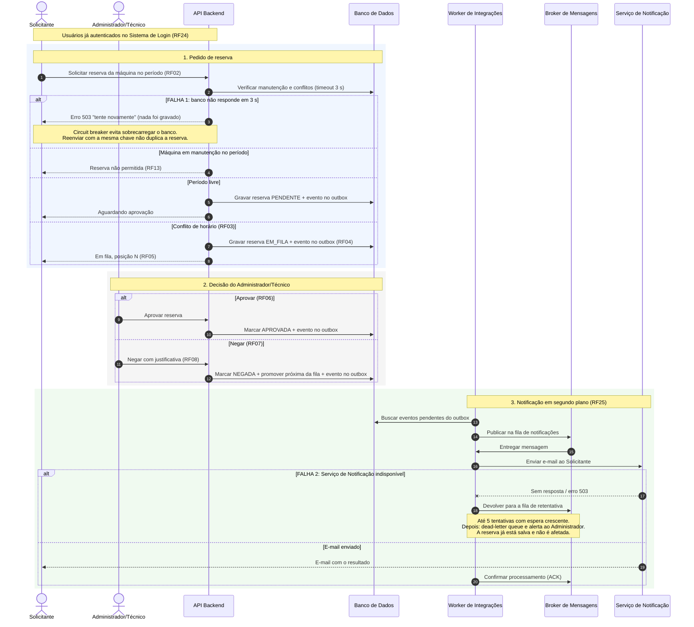

## 4. Sequência: compra de insumos

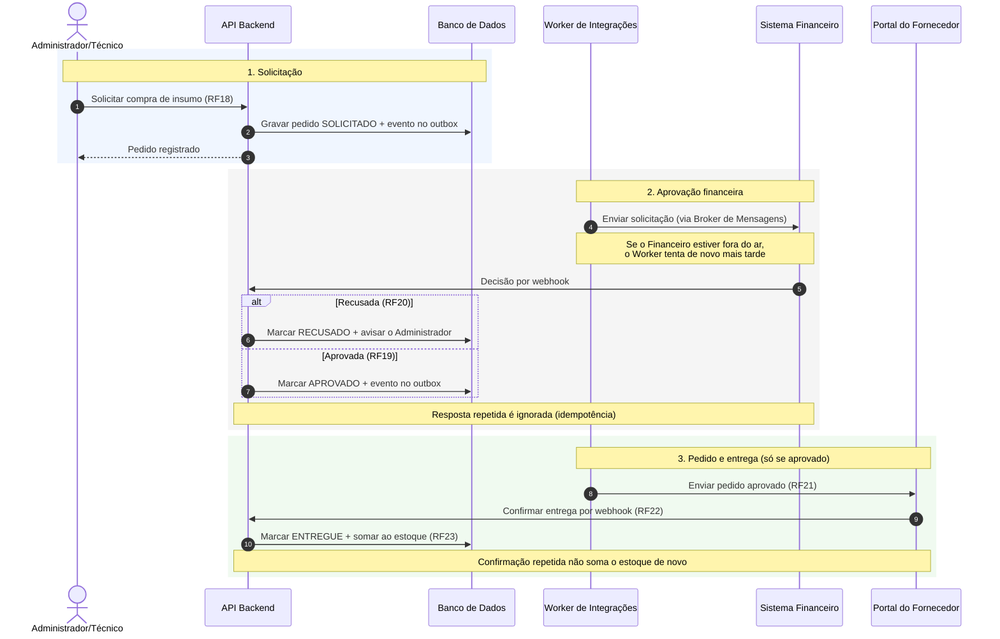

## 5. Sequência: manutenção de máquina

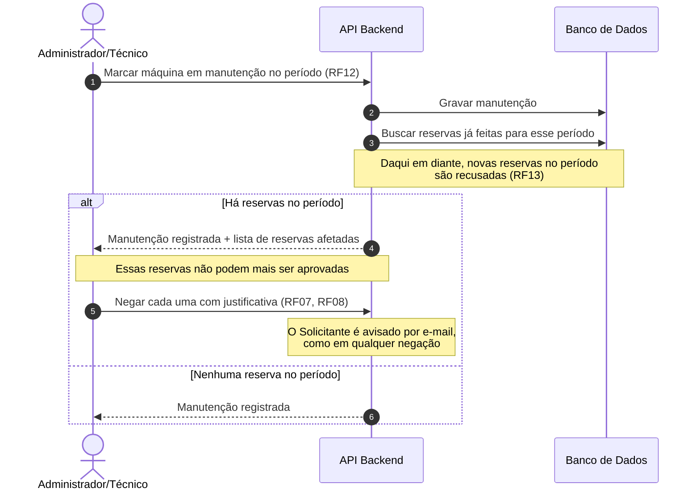

## 6. Classes: interfaces e injeção de dependência

Cada serviço recebe as dependências como interfaces pelo construtor.

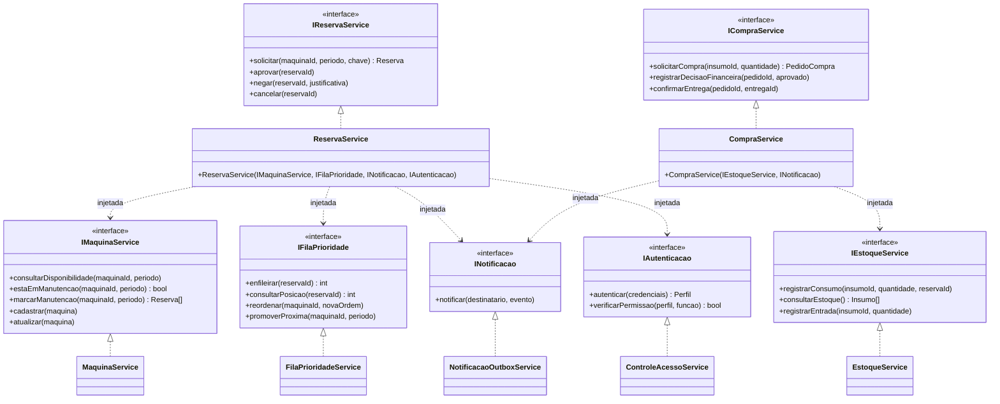

## 7. Modelo de domínio

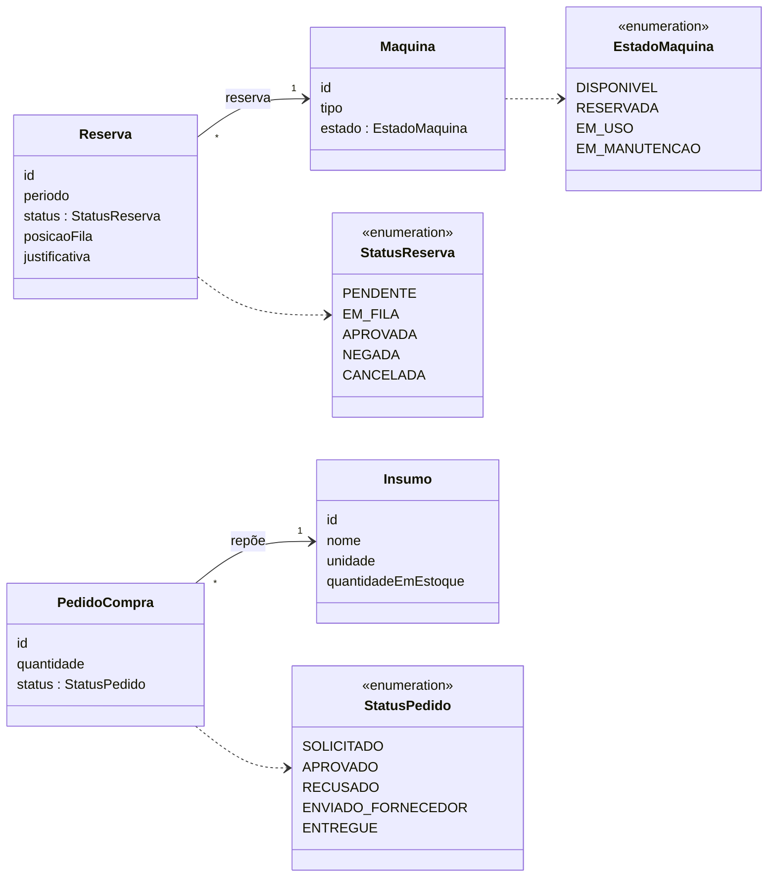

## 8. Componentes da API Backend (C4 Nível 3)

Cada seta mostra a interface usada.

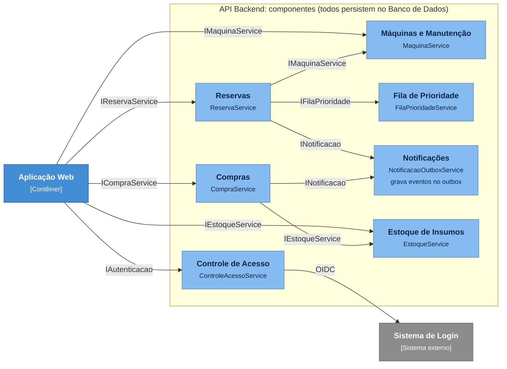

## 9. Atividades: reserva

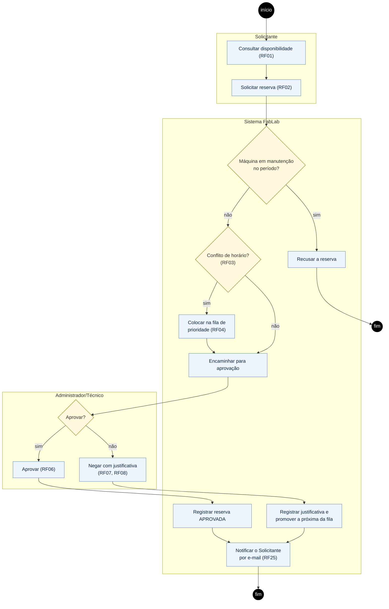

## 10. Atividades: cancelamento

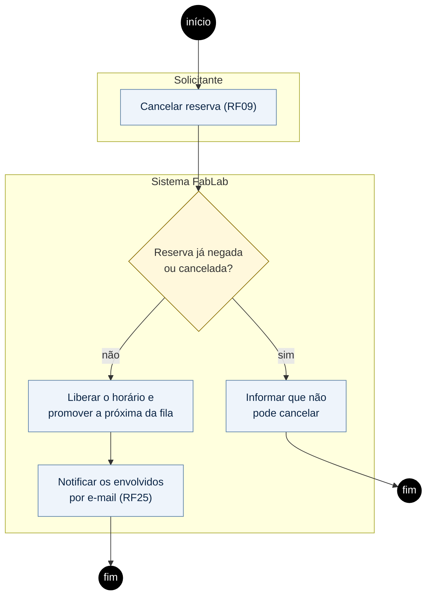

## 11. Estados da Reserva

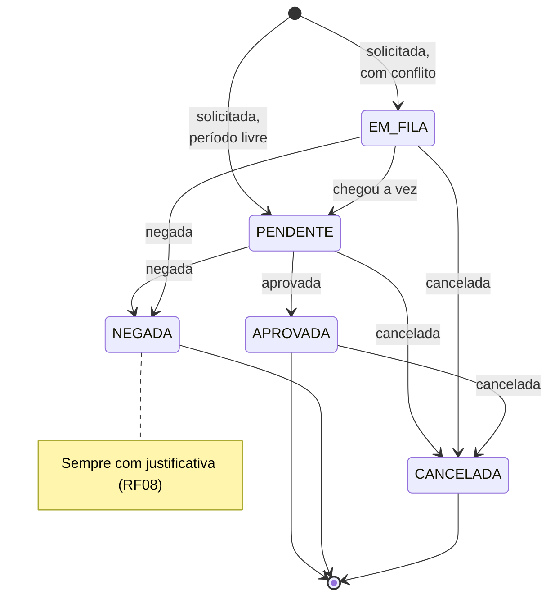

## 12. Estados do Pedido de Compra

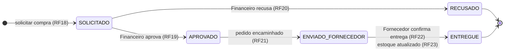
