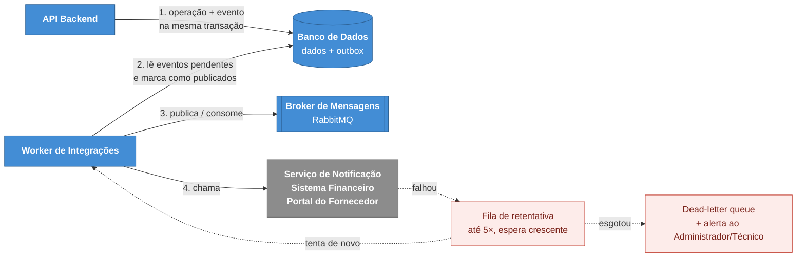

# ADR 0001: RabbitMQ com padrão Transactional Outbox para notificações e integrações externas

| Campo | Valor |
|---|---|
| **Status** | Aceito |
| **Data** | 24/11/2026 |
| **Sistema** | Sistema FabLab (Projeto Integrador) |
| **Requisitos afetados** | RF18–RF23 (compras), RF25 (notificações) |
| **Diagramas relacionados** | [C4 Nível 2](../architecture/c4-containers-visual.mmd), [Sequência de reserva](../architecture/sequencia-reserva.mmd), [Sequência de compra](../architecture/sequencia-compra.mmd) |

## Contexto

O Sistema FabLab depende de quatro sistemas externos: **Sistema de Login**, **Serviço de Notificação** (e-mail), **Sistema Financeiro** e **Portal do Fornecedor**. Na versão anterior do diagrama de contêineres, a API chamava todos eles de forma **síncrona** por HTTPS.

Esse acoplamento cria problemas concretos para o domínio:

- **Notificações (RF25):** se o Serviço de Notificação estiver fora do ar ou lento, a aprovação ou negação de uma reserva falha ou fica lenta, embora o e-mail seja um efeito secundário da operação.
- **Compras (RF18–RF23):** o Sistema Financeiro e o Portal do Fornecedor podem demorar, cair ou responder em duplicidade. Uma chamada síncrona prende a requisição e uma resposta repetida pode gerar duas aprovações ou duas entradas no estoque.
- **Consistência:** publicar um evento direto num broker *depois* de gravar no banco pode perder o evento se o processo cair entre as duas operações. Publicar *antes* pode avisar sobre algo que não foi gravado.

O plano de Chaos Engineering do projeto (`docs/architecture/chaos_engineering.pdf`) já define, como estado estável esperado:
- experimento 2: reserva e aprovação seguem funcionando com a notificação fora do ar, e os eventos são reenviados depois;
- experimentos 7 e 8: respostas duplicadas do Financeiro e do Fornecedor não geram efeito duplicado.

## Decisão

1. Adotar **RabbitMQ** como **Broker de Mensagens** para toda comunicação de saída com o Serviço de Notificação, o Sistema Financeiro e o Portal do Fornecedor.
2. Adotar o padrão **Transactional Outbox**. A **API Backend** grava o evento numa tabela `outbox` do **Banco de Dados** (PostgreSQL), **na mesma transação** da operação de negócio (aprovar, negar, cancelar, solicitar compra).
3. Criar o contêiner **Worker de Integrações**, que:
   - lê os eventos pendentes do outbox e os publica no broker;
   - consome as filas e chama os sistemas externos;
   - em caso de falha, devolve a mensagem para uma **fila de retentativa com atraso** (até 5 tentativas, backoff exponencial) e, ao esgotar, move-a para uma **dead-letter queue** com alerta ao Administrador/Técnico.
   - depois de publicar, marca o evento como **publicado** no outbox, para que ele não seja enviado de novo.
4. Tornar todos os consumidores e webhooks **idempotentes**: cada evento e cada confirmação externa tem um identificador único registrado, e o reprocessamento não repete o efeito.
5. O **Sistema de Login** continua **síncrono**: sem autenticação não há operação possível, e o sistema deve **falhar fechado** (experimento 1 do plano de chaos).

### Como funciona

## Consequências

### Positivas

- Indisponibilidade do e-mail, do Financeiro ou do Fornecedor **não bloqueia** reservas nem aprovações. Elas são concluídas e as notificações saem quando o serviço voltar.
- **Nenhum evento é perdido**: ele existe no banco desde o commit da operação, e o Worker o reenvia até conseguir.
- **Retentativa automática** com backoff, e a dead-letter queue torna visíveis as falhas definitivas.
- **Menor latência** para o usuário: a requisição termina no commit, sem esperar sistemas externos.
- A **idempotência** impede aprovação de compra duplicada e entrada de estoque duplicada (RF23).
- Novos consumidores de eventos (ex.: relatórios) podem ser adicionados sem alterar a API.

### Negativas (trade-offs)

- **Mais infraestrutura** para operar e monitorar: um broker e um processo Worker a mais.
- **Consistência eventual**: a notificação chega segundos ou minutos depois da operação, e não imediatamente.
- **Entrega "pelo menos uma vez"**: mensagens podem ser entregues mais de uma vez, o que obriga todo consumidor a ser idempotente.
- **Mais complexidade** de desenvolvimento e de testes: tabela outbox, controle de eventos publicados, filas de retentativa e DLQ.
- **A ordem das mensagens não é garantida** entre retentativas. Um e-mail de "aprovada" pode chegar depois de um de "cancelada"; o conteúdo de cada notificação deve trazer o status atual da reserva.
- O próprio broker passa a ser um ponto de falha. Ele é mitigado porque o outbox guarda os eventos enquanto o broker estiver fora, mas isso exige monitoramento do tamanho do outbox.

### O que precisa ser monitorado

| Indicador | Sinal de problema |
|---|---|
| Eventos pendentes no outbox | Crescendo sem parar: o Worker ou o broker estão fora |
| Mensagens na dead-letter queue | Qualquer mensagem: falha definitiva de um sistema externo |
| Tentativas por mensagem | Muitas retentativas: sistema externo instável |

## Alternativas consideradas

| Alternativa | Por que não foi escolhida |
|---|---|
| Manter chamadas HTTPS síncronas | Uma falha externa derruba a operação de reserva. Contradiz o experimento 2 do plano de chaos. |
| Publicar no broker direto da API, sem outbox | Risco de perder ou inventar eventos se a API cair entre o commit e a publicação. |
| Apache Kafka | Pensado para alto volume e reprocessamento de histórico, que o FabLab não tem. Não oferece fila de retentativa com atraso pronta e é mais pesado de operar que o RabbitMQ. |
| Fila só em tabela do banco (sem broker) | Funciona para volume baixo, mas exigiria implementar retentativa com atraso, DLQ e distribuição entre consumidores manualmente. |
