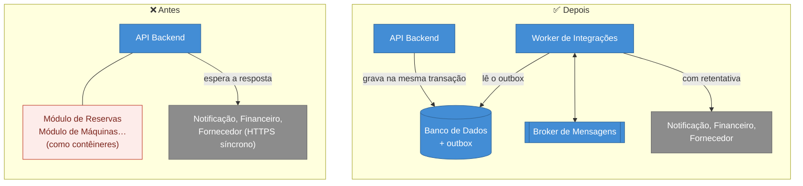

# Auditoria do C4 Nível 2 (Contêineres): Sistema FabLab

| | |
|---|---|
| **Diagrama corrigido** | [`c4-containers-visual.mmd`](c4-containers-visual.mmd) (versão legível) e [`c4-containers.mmd`](c4-containers.mmd) (notação C4 oficial) |
| **Decisão relacionada** | [ADR 0001: RabbitMQ com Transactional Outbox](../adr/0001-escolha-tecnologica.md) |
| **Data** | 24/11/2026 |

## Resumo

| # | Problema | Gravidade | Situação |
|---|---|---|---|
| 1 | Acoplamento síncrono com sistemas externos | 🔴 Alta | ✅ Corrigido |
| 2 | Pontos únicos de falha (SPOF) e consistência | 🟠 Média | ⚠️ Corrigido em parte: a redundância fica como recomendação para produção |
| 3 | Granularidade incorreta do nível 2 | 🟡 Baixa | ✅ Corrigido |

## Antes e depois

## Análise

### 1. Acoplamento síncrono com sistemas externos

- **Problema:** a API chamava o Serviço de Notificação, o Sistema Financeiro e o Portal do Fornecedor diretamente por HTTPS.
- **Impacto:** uma queda do e-mail derrubava a aprovação de reservas, embora o e-mail seja só um efeito secundário. Uma resposta repetida do Financeiro ou do Fornecedor podia aprovar a compra duas vezes ou somar o estoque em dobro.
- **Correção:** as integrações de saída passam pelo **Broker de Mensagens** (RabbitMQ) e pelo **Worker de Integrações**, com retentativa, dead-letter queue e consumidores idempotentes. Só o **Sistema de Login** continua síncrono e falha fechado: sem autenticação nenhuma operação é possível.

### 2. Pontos únicos de falha (SPOF) e consistência

- **Problema:** a **API Backend** e o **Banco de Dados** são instâncias únicas, e publicar eventos fora da transação podia perder notificações. Com a correção do item 1, o **Broker de Mensagens** também vira um ponto de falha.
- **Impacto:** se a API cair entre gravar a reserva e publicar o evento, o Solicitante nunca recebe o e-mail. Um banco lento prende as requisições e sobrecarrega o sistema.
- **Correção:**
  - os eventos são gravados no **outbox** na mesma transação da operação, então nada se perde se a API ou o broker caírem;
  - as chamadas ao banco têm **timeout de 3 s com circuit breaker**;
  - as requisições de reserva usam **chave de idempotência**, para que o reenvio não duplique a reserva.
- **Pendente (recomendação para produção):** mais de uma instância da API atrás de um balanceador de carga e réplica do PostgreSQL.

### 3. Granularidade incorreta do nível 2

- **Problema:** o diagrama listava "Módulo de Reservas", "Módulo de Máquinas" etc. como contêineres, embora fossem componentes da mesma API (a própria descrição dizia "Componente do backend").
- **Impacto:** o diagrama misturava os níveis 2 e 3 do C4 e não mostrava o que de fato é implantado.
- **Correção:** o nível 2 mostra apenas unidades implantáveis: **Aplicação Web, API Backend, Worker de Integrações, Broker de Mensagens e Banco de Dados**. Os módulos estão no diagrama de componentes ([`componentes.mmd`](componentes.mmd)).
